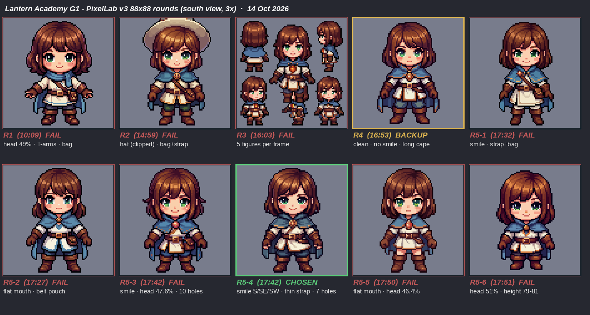
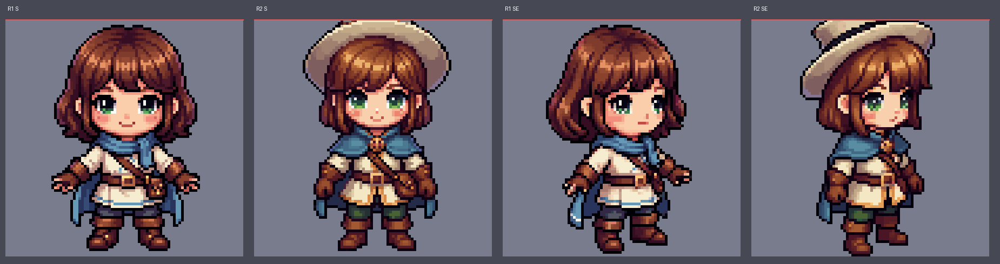
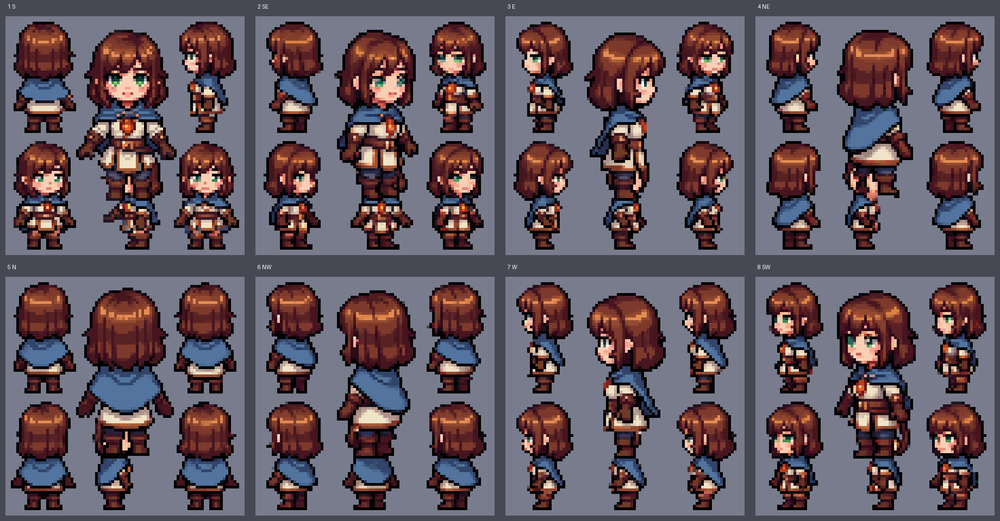
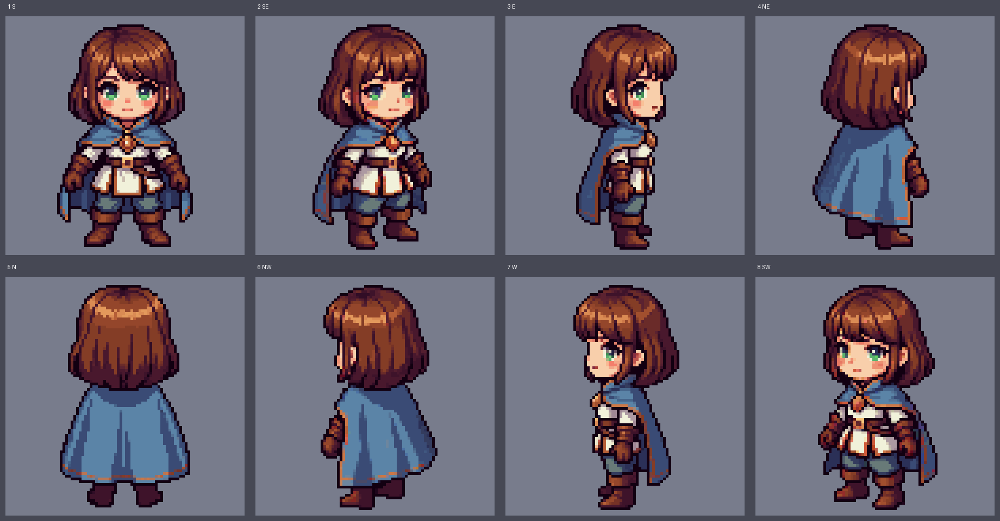
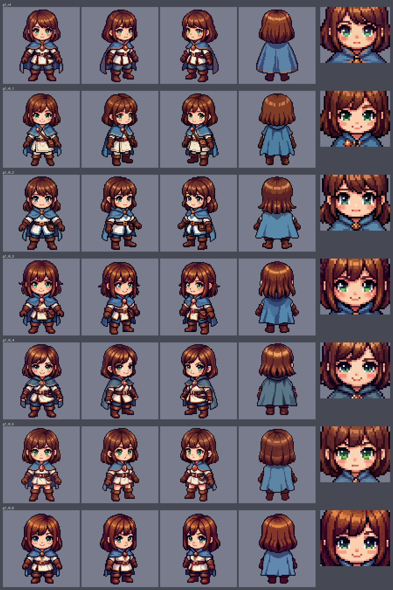
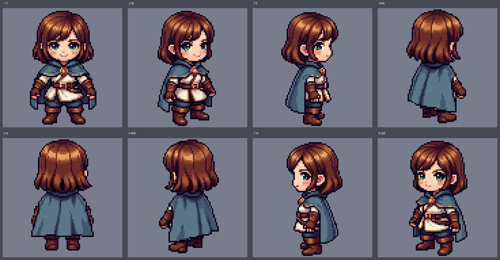
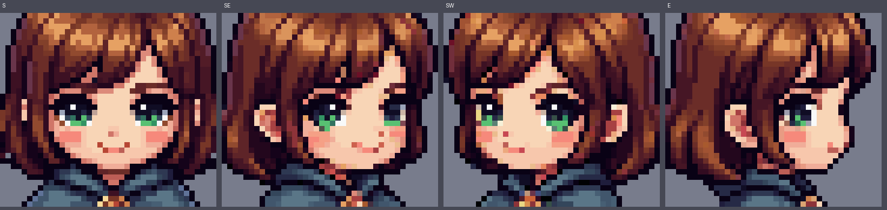
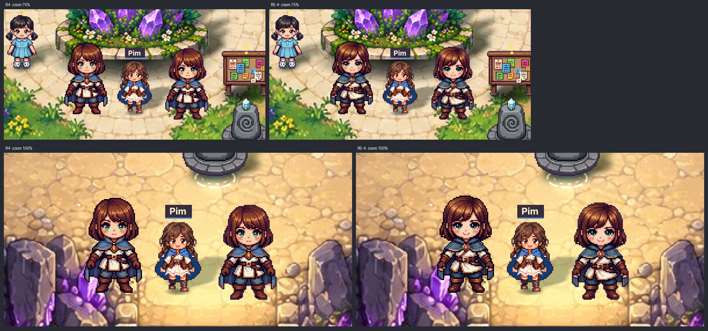
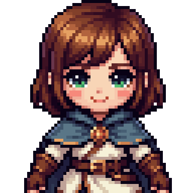

# Lantern Academy · สรุปงาน G1.3 → G1.4 (14 ต.ค. 2569 · 20:30)
ผู้สรุป: Claude · ไฟล์นี้อยู่ใน branch ภาพชั่วคราว `review/g1-3-images` (ไม่ merge · ลบเมื่อจบ G1)
เอกสารหลักที่ล็อกแล้ว: PR #7 https://github.com/phoneyjung/Leah-PP/pull/7 · branch `plan/g1-3-character-art-direction-v2` · commit ล่าสุด `1e0463c`
- `CHARACTER_ART_DIRECTION_V2.md` (ข้อ 1–15 · ผลทุกรอบ + มติ + เตรียม Portrait)
- `VISUAL_BIBLE_G1_V1_1.md` (แก้เฉพาะจุด)

---

## 1. สถานะตอนนี้ (สั้น)
| เรื่อง | สถานะ |
|---|---|
| Character Art Direction v2 "Soft Heroic Pixel" | ✅ เจ้าของอนุมัติ |
| ตัวต้นแบบ G1 | ✅ **รอบ 5 ไฟล์ _4** = Character Style Reference ที่อนุมัติแล้ว · ❗ยังไม่ใช่ไฟล์ใส่เกม (ยังไม่ผ่าน QA) |
| ผ้าคลุม | ✅ ล็อกเป็น **ผ้าคลุมยาว = ชุดนักเรียนทางการ** ตามรูปทรง _4 · สีเปลี่ยนตาม `S.house` |
| G1.4 Portrait 384 | 🟡 เตรียมพรอมป์ ค่าตั้ง ภาพอ้างอิงแล้ว · **รอภาพหน้าจอราคา 384 + อนุมัติ** · ยังไม่ Generate |
| เครดิต G1 | ใช้ไปประมาณ **20/65** (10 ครั้ง × 2) · เหลือประมาณ 45 |
| โค้ดเกม / เซฟ / Firebase / main | ไม่ได้แตะ |

ภาพรวมทุกรอบ (ทิศ S ขยาย 3 เท่า · เขียว = เลือก · เหลือง = สำรอง · แดง = ไม่ผ่าน)



---

## 2. ลำดับงานและผลแต่ละรอบ (PixelLab v3 · Low Top-Down · 88×88 · Highly detailed · Outline Default)
| รอบ | เวลา | พรอมป์ (commit) | ผลหลัก | สรุป |
|---|---|---|---|---|
| 1 | 10:09 | G1.1 (ก่อน PR #7) | สูง 82–85 · หัว **49%** · แขนกางแบบตัว T · มีกระเป๋า/สายคาด · ขอบดำ | Technical Reference ด้านสเกล |
| 2 | 14:59 | `8d1f9fd` | **มีหมวกปีกกว้าง** (โดนตัดขอบบน 20–37 px ทุกทิศ) · **กระเป๋า+สายคาด** · ปาก SE/SW เป็นจุด | ❌ |
| 3 | 16:03 | `cb64582` | **ทุกกรอบเป็นแผ่นรวม 5 ตัว** (เพราะประโยครายชื่อ 8 ทิศ) · หมวก/กระเป๋าหายแล้ว | ❌ |
| 4 | 16:53 | `9c28e3f` | ตัวเดียว · สูง 82–83 · หัว 42.7% · รูใส 0 · ไม่มีกระเป๋า · **ไม่ยิ้ม · คิ้วไม่เห็น · ผ้าคลุมยาว** | 🟡 สำรอง |
| 5 (×6) | 17:27–17:51 | `0f4d72d` | ยิ้มได้บางภาพ แต่กระเป๋า/สายกลับมาแบบสุ่ม · ผ้าคลุมยาวทุกภาพ | ✅ เลือก **_4** |

ภาพประกอบ
- รอบ 1 เทียบ 2 (หมวกชนขอบบน): 
- รอบ 3 แผ่นรวมหลายตัว: 
- รอบ 4 ครบ 8 ทิศ: 
- รอบ 4 + รอบ 5 ทั้ง 6 ไฟล์ (S / SE / SW / N + หน้า): 

### ตารางรอบ 5 (พรอมป์เดียวกัน 6 ครั้ง)
| | 5-1 | 5-2 | 5-3 | **5-4** | 5-5 | 5-6 |
|---|---|---|---|---|---|---|
| ปาก | ยิ้ม ✓ | เส้นตรง ✗ | ยิ้ม ✓ | **ยิ้ม S/SE/SW เหมือนกัน ✓** | เส้นตรง ✗ | ยิ้มเล็ก |
| หัว | 42.2% ✓ | 42.9% ✓ | 47.6% ✗ | **44.0–45.2% ✓** | 46.4% ✗ | 51.2% ✗ |
| สูง | 82–83 | 83–84 | 82–84 | **82–85** | 82–84 | 79–81 ✗ |
| กระเป๋า/สาย | สาย+กระเป๋า ✗ | กระเป๋าเข็มขัด ✗ | กระเป๋าเข็มขัด ✗ | **สายเส้นบาง** | — | — |
| รูใส | 2 | 0 | 10 | **7** | 1 | 0 |
| ผ้าคลุม | ยาว | ยาว | ยาว | **ยาว · สีหม่น `#5A7687`** | ยาว | ยาว |

---

## 3. บทเรียนเรื่องพรอมป์ PixelLab v3 (ใช้ต่อกับตัวละครตัวอื่น)
1. **ห้ามเขียน "no hat / no bag"** → PixelLab ใส่ของนั้นเอง · ใช้ประโยคบอกสิ่งที่ต้องการแทน ("Bare head showing the whole hairstyle", "Nothing is worn across the chest or at the hips except the belt")
2. **คำว่า "adventurer" ชวนให้ใส่หมวกและกระเป๋า** → ใช้ "apprentice"
3. **ห้ามเขียนรายชื่อทิศ/มุมมองในพรอมป์** (S, SE … back views) → ได้แผ่นรวมหลายตัวในกรอบเดียว · PixelLab หมุน 8 ทิศให้เอง · กติกาทิศใช้เป็นเกณฑ์ตรวจรับเท่านั้น
4. ใช้ "a single full-body figure" + "Full body centered on a transparent background" → ได้ตัวเดียวทุกครั้ง (7/7 ภาพหลังแก้)
5. **ความยาวผ้าคลุมสั่งด้วยข้อความไม่ได้** (7/7 ภาพยาวถึงน่องแม้เขียน "ends at the elbows") → เจ้าของรับเป็นดีไซน์ทางการ
6. ผลแต่ละครั้งสุ่ม: ยิ้มชัด 3/6 · กระเป๋า/สายโผล่ 4/6 → เลือกจากหลายภาพดีกว่าแก้พรอมป์ซ้ำ
7. สั่งหัว "38 percent" ได้จริง 42–51% (PixelLab ทำหัวโตกว่าที่สั่ง)

---

## 4. ตัวต้นแบบที่เลือก: รอบ 5 ไฟล์ _4


วางในเกมจริง 844×390 (ซ้าย = รอบ 4 · ขวา = 5-4 · บน ซูม 75% · ล่าง ซูม 100%):


**ค่าวัด:** สูง 82–85 px · ลงกรอบ 96 ไม่เสียพิกเซล เท้าแถว 94 · หัว 44.0–45.2% · ยิ้มปิดกว้าง 6 px เหมือนกันใน S/SE/SW · ตาเขียว ประกายบนซ้าย ขนตาดำหนา · ทิศหลังไม่มีตา · สีใกล้ทองสัญญาณ/ฟ้าคริสตัล 0

**งานเก็บก่อนเป็นไฟล์ใส่เกม (G2 · ยังไม่ทำ · ไม่แก้ภาพต้นฉบับ)**
1. ลบสายเส้นบางพาดอก
2. ปิดรูใส 7 จุด (พิกัดภาพ 88): S (25,36) (63,36) · NE (54,34)×2 px, (55,36), (56,37) · NW (33,35), (32,36)×3 px → ต้องเป็น 0
3. ทำหน้ากากผ้าคลุม = วัสดุ "บ้าน" แล้วใช้ ramp สีบ้านเดิม (Wing `#133C72 #1B56A4 #2370D5 #508FE2` ฯลฯ) แทน `#5A7687`
4. ขอบนอกพลัม `#3A1E3F` (ทดสอบแล้วใน G1.2 · เปลี่ยนเฉพาะขอบนอก)
5. หน้ากากตาทุกทิศ (เพื่อเปลี่ยนสีตา 5 สี)

---

## 5. มติที่ล็อกแล้ว (G1.3 Final Lock · แนวทาง A)
- รอบ 5 _4 = Character Style Reference ที่อนุมัติแล้ว (ไม่ใช่ Production Asset)
- ผ้าคลุมยาว = ชุดนักเรียน Lantern Academy ทางการ · รูปทรง/ความยาวตาม _4 · ไม่ออกแบบใหม่
- สีผ้าคลุมเปลี่ยนตาม `S.house` ด้วย Palette บ้านเดิม · ไม่เปลี่ยนค่าในเซฟ
- เข็มกลัดโคมทองแดงสีคงที่ (`#915B49` `#BB7A57`) · ไม่ใช้ทองสัญญาณ `#FFC857`
- คงหน้า ผม สัดส่วน ยิ้ม ชุด · Sprite 96×96 · ต้นทาง 88 · เท้า [48,94] · ปากไม่ใช่ตัวเลือกแต่งตัว · ไม่มีกระเป๋าติดตัว

---

## 6. G1.4 Portrait 384×384 — เตรียมแล้ว ยังไม่ Generate
**เครื่องมือจริง (ภาพหน้าจอเจ้าของ 20:17):** `pixellab.ai/create` → **Create S-XL image (Pro)** → แท็บ Pro · Mode Pro
- Output size ไม่มี 384×384 สำเร็จรูป (มี 341×341 และ 512×512) → ติ๊ก **Custom size (Beta)** ตั้ง 384×384 · สำรอง: 341×341 แล้วเติมขอบโปร่งใสเป็น 384 (ไม่ขยายภาพ)
- ติ๊ก **Remove background**
- **Reference images** สูงสุด 4 ภาพ (ระบบย่อ/ขยายเองถึง 1024) ต้องเรียกในพรอมป์ว่า "reference image 1" → ใช้ `g14-ref-r5-4-bust-384.png`
- **Style image ปล่อยว่าง** (ระบบจะเปลี่ยนขนาดผลลัพธ์ตามภาพนั้น และจะลอกสีผ้าคลุมหม่นมา)
- ราคาที่เห็นที่ 128×128 = 10 generations · ตามคู่มือ 342–512 px = **25** · **ยังไม่เห็นราคา 384 จริง**

ภาพอ้างอิง (ตัดครึ่งตัวจาก _4 ขยายแบบพิกเซลคม 6 เท่า · ใช้นำทางเท่านั้น ไม่ใช่ผลงาน):


**พรอมป์ Portrait (1,298 ตัวอักษร · คำต้องห้าม 0)**
```text
Half-body portrait of one original cute girl apprentice of a lantern academy, about 10 years old, the same character as reference image 1, facing the viewer, framed from the top of her head to her waist and centered. Detailed modern pixel art with crisp square pixels, warm and gently brave. Beautiful expressive face with a soft rounded shape: large eyes with a thick solid black upper lash line and a tiny outer flick, two-tone green irises with darker pupils, one small white highlight at the upper left of each eye, thin soft brown eyebrows just above short soft bangs, a tiny nose, soft pink cheeks and a small closed smile with both corners turned up. Chestnut brown chin-length bob hair with soft bangs and side locks that frame the cheeks, drawn in clean chunky clusters. Ivory academy tunic with small copper buttons and a warm brown leather belt, brown leather gloves. A long medium blue cape with a wide soft collar over both shoulders, fastened at the chest with a small round muted copper badge shaped like a lantern. Bare head showing the whole hairstyle, relaxed empty hands. Each material in its own clean color ramp, dark plum outlines, light from the upper left, three to four shading steps per material. Transparent background. No floor, no cast shadow, no glow effects, no text.
```

**ความเสี่ยง:** ลองได้จริงครั้งเดียวในงบ (25) · ภาพอ้างอิงอาจทำให้ลอกพิกเซลก้อนใหญ่/สายพาดอก/สีหม่น · อาจได้เต็มตัวหรือหน้าเนียนแบบอนิเมะ · ปาก/ตาอาจไม่เหมือน _4

**รอจากเจ้าของ:** ภาพหน้าจอ (1) ราคาหลังตั้ง 384 (2) ราคาหลังอัปภาพอ้างอิง (3) ยอดเครดิตหน้า Account (ไม่ติด API Key) → Claude คำนวณงบ → เจ้าของอนุมัติ → จึงกด

---

## 7. เครดิต
| งาน | ครั้ง | ราคา/ครั้ง | รวม |
|---|---|---|---|
| รอบ 1–4 | 4 | 2 (เห็นบนจอ) | 8 |
| รอบ 5 | 6 | 2 (คาด) | 12 |
| **ใช้แล้ว** | | | **≈ 20 / 65** |
| Portrait 384 (ยังไม่ทำ) | 1 | ~25 (คู่มือ) | → ≈ 45 |
| ภาพนิ่ง 128 (ยังไม่ทำ) | 1 | ~10 (เห็นบนจอที่ 128 = 10) | → ≈ 55 |

---

## 8. ยังไม่ทำ / ขั้นต่อไป
- ยังไม่ Generate Portrait · ยังไม่อัปภาพอ้างอิง · ยังไม่ทำภาพนิ่ง 128 (G1.5) · ยังไม่ลงมติ G1.6
- ยังไม่แก้ภาพต้นฉบับ / ไม่ทำงานเก็บ G2 · ไม่แตะโค้ดเกม เซฟ Firebase · ไม่แก้ PR #5/#6 · ไม่ merge
- สเปก v2 (PR #5) ยังรอแก้: ปากไม่ใช่ชิ้นแต่งตัว · Portrait 256 → 384 · ผ้าคลุมยาว
- ลีอายังไม่ได้ลองเล่นระบบแต่งตัว
